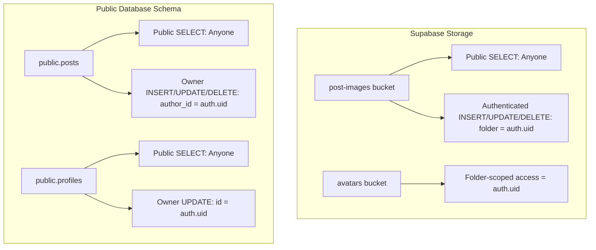

# Supabase Row-Level Security (RLS) Policies & Storage Setup

This document records all Row Level Security (RLS) policies and storage configurations active in the Supabase project, including both the newly configured `post-images` storage bucket and the existing database and storage policies.

---

## 1. Storage Buckets & Policies (`storage` schema)

### 1.1 Bucket: `post-images` (Configured in This Session)
- **Bucket ID**: `post-images`
- **Public**: `true` (enables direct public URL access via CDN)
- **File Size Limit**: `10,485,760` bytes (10 MB)
- **Allowed MIME Types**: Unrestricted (`NULL`)

#### Storage Bucket Registration SQL:
```sql
INSERT INTO storage.buckets (id, name, public, file_size_limit, allowed_mime_types)
VALUES (
  'post-images',
  'post-images',
  true,
  10485760, -- 10 MB
  NULL
)
ON CONFLICT (id) DO UPDATE SET
  public = EXCLUDED.public,
  file_size_limit = EXCLUDED.file_size_limit,
  allowed_mime_types = EXCLUDED.allowed_mime_types;
```

#### RLS Policies on `storage.objects` for `post-images`:

| Policy Name | Action (`cmd`) | Target Role | Security Definition |
| :--- | :---: | :---: | :--- |
| **Public Access post-images** | `SELECT` | `public` | `bucket_id = 'post-images'` |
| **Authenticated users can upload to post-images own folder** | `INSERT` | `authenticated` | `bucket_id = 'post-images' AND (storage.foldername(name))[1] = (SELECT auth.uid()::text)` |
| **Authenticated users can update in post-images own folder** | `UPDATE` | `authenticated` | **USING & WITH CHECK**:<br>`bucket_id = 'post-images' AND (storage.foldername(name))[1] = (SELECT auth.uid()::text)` |
| **Authenticated users can delete from post-images own folder** | `DELETE` | `authenticated` | `bucket_id = 'post-images' AND (storage.foldername(name))[1] = (SELECT auth.uid()::text)` |

#### SQL Definitions:
```sql
-- 1. Public SELECT: Allow anyone to view and download images
CREATE POLICY "Public Access post-images"
ON storage.objects
FOR SELECT
TO public
USING (bucket_id = 'post-images');

-- 2. Authenticated INSERT: Users can only upload inside [auth.uid()]/ folder
CREATE POLICY "Authenticated users can upload to post-images own folder"
ON storage.objects
FOR INSERT
TO authenticated
WITH CHECK (
  bucket_id = 'post-images'
  AND (storage.foldername(name))[1] = (SELECT auth.uid()::text)
);

-- 3. Authenticated UPDATE: Users can only update/overwrite files inside [auth.uid()]/ folder
CREATE POLICY "Authenticated users can update in post-images own folder"
ON storage.objects
FOR UPDATE
TO authenticated
USING (
  bucket_id = 'post-images'
  AND (storage.foldername(name))[1] = (SELECT auth.uid()::text)
)
WITH CHECK (
  bucket_id = 'post-images'
  AND (storage.foldername(name))[1] = (SELECT auth.uid()::text)
);

-- 4. Authenticated DELETE: Users can only delete files inside [auth.uid()]/ folder
CREATE POLICY "Authenticated users can delete from post-images own folder"
ON storage.objects
FOR DELETE
TO authenticated
USING (
  bucket_id = 'post-images'
  AND (storage.foldername(name))[1] = (SELECT auth.uid()::text)
);
```

---

### 1.2 Bucket: `avatars` (Pre-existing in Project)
- **Bucket ID**: `avatars`
- **Public**: `true`
- **File Size Limit**: `10,485,760` bytes (10 MB)
- **Allowed MIME Types**: `NULL`

#### Active RLS Policies on `storage.objects` for `avatars`:

| Policy Name | Action | Target Role | Condition |
| :--- | :---: | :---: | :--- |
| **Give users access to own folder 1oj01fe_0** | `SELECT` | `public` | `bucket_id = 'avatars' AND (storage.foldername(name))[1] = (SELECT auth.uid()::text)` |
| **Give users access to own folder 1oj01fe_1** | `UPDATE` | `public` | `bucket_id = 'avatars' AND (storage.foldername(name))[1] = (SELECT auth.uid()::text)` |
| **Give users access to own folder 1oj01fe_2** | `INSERT` | `public` | `bucket_id = 'avatars' AND (storage.foldername(name))[1] = (SELECT auth.uid()::text)` |
| **Give users access to own folder 1oj01fe_3** | `DELETE` | `public` | `bucket_id = 'avatars' AND (storage.foldername(name))[1] = (SELECT auth.uid()::text)` |

---

## 2. Database Table Policies (`public` schema)

### 2.1 Table: `public.posts`
RLS is enabled (`rls_enabled = true`).

| Policy Name | Action (`cmd`) | Target Role | Condition / Expression |
| :--- | :---: | :---: | :--- |
| **Posts are viewable by everyone** | `SELECT` | `public` | `true` |
| **Authenticated users can create posts** | `INSERT` | `authenticated` | `WITH CHECK (auth.uid() = author_id)` |
| **Users can update their own posts** | `UPDATE` | `authenticated` | `USING (auth.uid() = author_id)`<br>`WITH CHECK (auth.uid() = author_id)` |
| **Users can delete their own posts** | `DELETE` | `authenticated` | `USING (auth.uid() = author_id)` |

#### SQL Definitions:
```sql
ALTER TABLE public.posts ENABLE ROW LEVEL SECURITY;

CREATE POLICY "Posts are viewable by everyone"
ON public.posts
FOR SELECT
TO public
USING (true);

CREATE POLICY "Authenticated users can create posts"
ON public.posts
FOR INSERT
TO authenticated
WITH CHECK (auth.uid() = author_id);

CREATE POLICY "Users can update their own posts"
ON public.posts
FOR UPDATE
TO authenticated
USING (auth.uid() = author_id)
WITH CHECK (auth.uid() = author_id);

CREATE POLICY "Users can delete their own posts"
ON public.posts
FOR DELETE
TO authenticated
USING (auth.uid() = author_id);
```

---

### 2.2 Table: `public.profiles`
RLS is enabled (`rls_enabled = true`).

| Policy Name | Action (`cmd`) | Target Role | Condition / Expression |
| :--- | :---: | :---: | :--- |
| **Profiles are viewable by everyone** | `SELECT` | `public` | `true` |
| **Users can update their own profile** | `UPDATE` | `authenticated` | `USING (auth.uid() = id)`<br>`WITH CHECK (auth.uid() = id)` |

#### SQL Definitions:
```sql
ALTER TABLE public.profiles ENABLE ROW LEVEL SECURITY;

CREATE POLICY "Profiles are viewable by everyone"
ON public.profiles
FOR SELECT
TO public
USING (true);

CREATE POLICY "Users can update their own profile"
ON public.profiles
FOR UPDATE
TO authenticated
USING (auth.uid() = id)
WITH CHECK (auth.uid() = id);
```

---

## 3. Quick Reference Matrix


